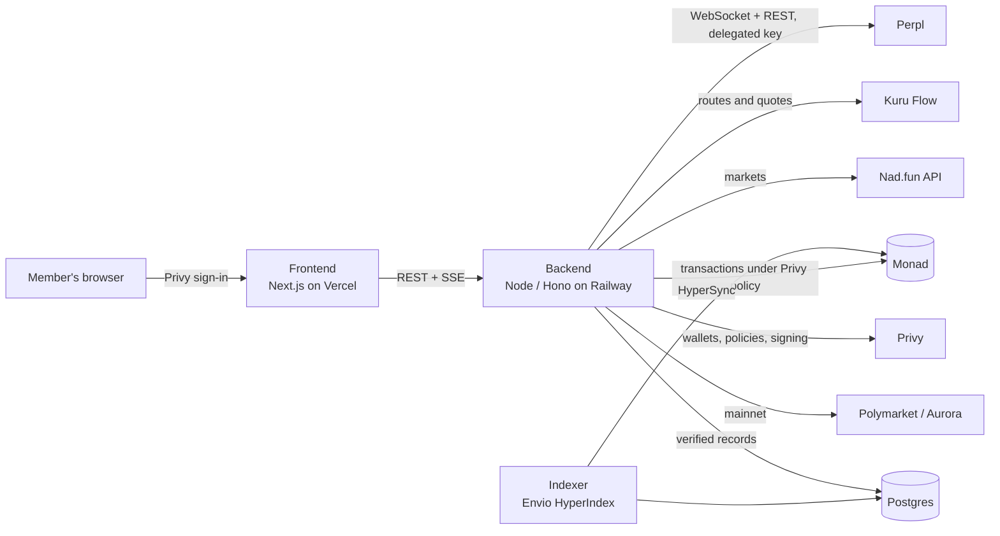

# Cult

**Social trading on Monad.** Cult lets small groups, called *cults*, trade together. Members
trade perpetual futures on **Perpl** and Monad-native tokens on **Nad.fun** from their own
wallets. A member can switch on **Auto-follow** to have a cult's shared trades copied into
their own account, sized to their own balance and limits. Every track record is **verified
from the chain**, not self-reported.

| | |
|---|---|
| **App** | https://cult-trades.vercel.app |
| **API** | https://cult-production-e803.up.railway.app (`GET /v1/health`, `GET /v1/status`) |
| **API contract** | [`CONTRACTS.md`](CONTRACTS.md) |
| **Network** | Monad testnet (10143) today; mainnet (143) is configured and checked |

Balances and results are always shown in US dollars. Everything settles in AUSD (Agora's
dollar stablecoin, redeemable 1:1 for USD); the token name appears only on the funding screen.

---

## Contents

- [Features](#features)
- [How copy trading works](#how-copy-trading-works)
- [Verified track records](#verified-track-records)
- [Integrations](#integrations)
- [Security model](#security-model)
- [Architecture](#architecture)
- [Getting started](#getting-started)
- [Deployment](#deployment)
- [Moving to mainnet](#moving-to-mainnet)
- [Testing and verification](#testing-and-verification)
- [License](#license)

---

## Features

**Accounts and funding**
- Sign in with Google or an existing wallet. Privy creates an embedded wallet that the
  member owns.
- One dollar balance across the wallet, the Perpl trading account and predictions.
- Deposit MON, USDC or AUSD. USDC converts to AUSD automatically, and perp margin is topped
  up from the wallet when a trade needs it.
- A wallet without MON for network fees is told how to get it: free from Monad's faucet on testnet, or by depositing MON on mainnet.
- Withdrawals are protected by a 4-digit PIN.

**Trading**
- Perpetual futures on Perpl: long or short, stake times leverage, take-profit and stop-loss
  as on-chain trigger orders, and closing one trade, part of it, or a whole market.
- Nad.fun tokens: buy and sell, paid in MON on testnet and in dollars on mainnet.
- One searchable market list with live charts.
- **Post to:** each trade can go to all of a member's cults, some of them, or none.

**Cults**
- Private cults are joined with a code such as `ABC-DEF`; public cults are listed in
  Discover and joined in one tap.
- Owners and admins: only admins' trades are shared with the cult, and the owner can't be
  removed or demoted.
- Every cult has a group chat that doubles as its activity feed, with replies, reactions,
  photos, shared charts and live trade cards.
- A shared chart shows every member's entries with live PnL. Members can suggest
  take-profit and stop-loss levels by dragging on a cult-mate's position.

**Social**
- Rooms for everyone (Global) and for each country.
- Leaderboards: global, per country, per cult, and public cults, over 7 days, 30 days or
  all time.
- Profiles with win rate, realized PnL, streak, average win and recent performance.
- A home feed of the week's best trades, and shareable PnL cards.
- Phone notifications.

**Mainnet-only** (built, and switched on with the mainnet cutover)
- Prediction markets through Polymarket, funded from the same dollar balance.
- Deposits and withdrawals from 30+ chains through Aurora Intents.

---

## How copy trading works

1. **Joining a cult never touches money.** Auto-follow is off by default.
2. **Turning on Auto-follow is a signed consent.** The member signs their limits once: the
   maximum dollars per trade and the maximum share of their balance. They are never asked
   again per trade.
3. **When an admin trades,** every follower gets a pending copy with a **20-second window
   to skip it**. The copy is sized from the follower's own balance and limits, and placed
   from the follower's own account.
4. **Copies track the trade.** When the admin adds, copies add the same share after the
   skip window. When the admin sells part, copies sell the same share straight away. When
   the admin exits, copies exit, unless the member has turned **Follow exits** off.
5. **Manual copies** ("stack on this trade") are always the member's own choice and never
   follow automatically.
6. **When a copy can't run,** the member sees why in plain words and what to do next, for
   example adding funds, finishing perps setup, or renewing trading permission. Nothing is
   sent that the venue would refuse.

---

## Verified track records

An Envio HyperIndex indexer reads Perpl position events and Nad.fun router events for Cult
members and computes each member's record.

- **Every close counts:** closing one trade, part of a position, or selling part of a token
  is recorded straight away with its realized PnL.
- Records count a member's **own** trades. Copied trades are shown separately.
- Return is realized PnL over what went in, so a winning trade never shows a negative return.
- Records feed profiles, leaderboards, the home feed and PnL cards, and refresh within
  seconds of a close.

---

## Integrations

| Service | Role in Cult |
|---|---|
| **Monad** | The chain. |
| **Perpl** | Perpetual futures. Each member enrolls a delegated Ed25519 API key, signed by the owner in the browser (EIP-712). The key can trade but can never withdraw. |
| **Nad.fun** | Token trading through the v2 router, from the member's own wallet. Trades are detected from the router's `Buy`/`Sell` logs. |
| **Kuru Flow** | Swaps: USDC→AUSD on arrival, MON→AUSD for perp margin, and AUSD↔MON for token trades paid in dollars. |
| **Privy** | Sign-in, embedded wallets and the policy engine. The backend is an additional signer on each wallet, limited by a per-member policy. |
| **Envio HyperIndex** | The indexer behind verified track records. |
| **Polymarket** | Prediction markets (mainnet). |
| **Aurora Intents** | Cross-chain deposits and withdrawals (mainnet). |
| **Vercel / Railway** | Frontend hosting / backend, indexer and Postgres hosting. |

---

## Security model

Cult is non-custodial. The backend can never move a member's money anywhere except into
that member's own positions.

- **Privy policy.** The backend signer may only:
  - approve and deposit AUSD into the member's own Perpl account, within a cap;
  - buy on Nad.fun within a cap, with tokens delivered to the member;
  - sell on Nad.fun, with proceeds paid to the member;
  - approve tokens to the Nad.fun router;
  - swap on Kuru Flow within a cap, with zero fees and output to the member.

  Anything else is refused by Privy before it is signed: withdrawals, transfers out, swaps
  to another recipient, account creation and key enrollment. This was verified against
  live Privy (24 refused, 9 allowed).
- **Perpl keys** can trade but not withdraw, and are sealed at rest (AES-256-GCM).
- **Signed consent.** Auto-follow limits are a human-readable signed message, stored with
  the member's settings.
- **Withdrawals** require the member's PIN; a reset requires signing in again.
- **No feedback loops.** Every order the engine sends is tagged before it leaves, so a copy
  is never mistaken for a new trade.
- **No double fills.** A copy is retried only if nothing reached the venue.
- **Crash-safe.** After a restart, anything caught mid-send is settled from what actually
  landed on-chain, and an exit is never sold twice.
- **Gas reserve.** The last 0.25 MON in a wallet is never spent, so a member can always exit.
- **Rate limits** per member and per IP, stricter on order routes. A preflight check guards
  every deploy.

---

## Architecture



| Path | Contents |
|---|---|
| `frontend/` | Next.js application (Vercel). Talks only to the backend API. |
| `backend/` | Node, Hono and SQLite: the copy-trading engine, venue adapters, Privy signer, funding, chats, leaderboards and the API with live updates (SSE). See [`backend/README.md`](backend/README.md). |
| `indexer/` | Envio HyperIndex project for verified per-wallet records. See [`indexer/README.md`](indexer/README.md). |
| `CONTRACTS.md` | The API contract between the three, including error codes. |

**Backend design.** A single `VenueAdapter` interface covers Perpl and Nad.fun. The copy
engine (`backend/src/mirror`) detects shared trades from Perpl's WebSocket and from Nad.fun
router logs, schedules copies with a skip window, sizes them from each follower's balance
and limits, places them through the adapter, and follows adds, partial sells and exits.
Errors are translated into plain language with stable codes in `backend/src/errors`.

---

## Getting started

Requirements: Node 24 (the backend also runs on 22.5+) and a Monad testnet RPC (the public
endpoint works).

```bash
# Backend: http://localhost:8787
cd backend && npm ci
cp .env.example .env               # Privy credentials and the key-sealing secret; see backend/README.md
npm run preflight                  # checks every setting and external service
npm run start:dev

# Frontend: http://localhost:3000
cd frontend && npm ci
cp .env.local.example .env.local   # NEXT_PUBLIC_CULT_API_BASE_URL=http://localhost:8787
npm run dev

# Indexer (optional locally; without it, records show as unverified)
cd indexer && npm ci
ENVIO_HASURA=false ENVIO_PG_HOST=... ENVIO_API_TOKEN=... npx envio start   # see indexer/README.md
```

Point the backend at the indexer with `INDEXER_PG_URL` (a read-only user) or
`INDEXER_GRAPHQL_URL`.

---

## Deployment

- **Frontend (Vercel):** root directory `frontend`, built from `main`. Requires
  `NEXT_PUBLIC_CULT_API_BASE_URL`, `NEXT_PUBLIC_PRIVY_APP_ID` and `NEXT_PUBLIC_MONAD_CHAIN_ID`.
- **Backend (Railway):** root `/backend`, config `/backend/railway.json` (build, start,
  pre-deploy preflight, health check, restart policy), a volume at `/data` with
  `DB_PATH=/data/cult.db`, and a single replica.
- **Indexer (Railway):** a Postgres database plus a service with root `/indexer`, config
  `/indexer/railway.json`, `ENVIO_HASURA=false`, `ENVIO_PG_*` from the database and
  `ENVIO_API_TOKEN`. Give the backend `INDEXER_PG_URL`.

---

## Moving to mainnet

1. **Indexer:** set `ENVIO_CONFIG=config.mainnet.yaml`. It starts a fresh index on its own.
2. **Backend:** set `PERPL_API_URL=https://app.perpl.xyz/api`,
   `PERPL_WS_URL=wss://app.perpl.xyz`, `PERPL_CHAIN_ID=143` and a mainnet RPC, then run
   `npm run preflight`.
3. **Frontend:** set `NEXT_PUBLIC_MONAD_CHAIN_ID=143` and redeploy.

On its first start on the new chain, the backend resets trading state (Perpl accounts and
keys, signer policies, trades, copies and block cursors). It keeps members, usernames,
photos, PINs, cults and chats, and turns Auto-follow off so that nobody copies with real
money until they choose to again.

---

## Testing and verification

```bash
cd backend && npm test && npx tsc --noEmit && npx tsx scripts/smoke-api.ts && npm run preflight
cd indexer && npm test
cd frontend && npx tsc --noEmit && npx next lint && npm run build
```

- **Backend:** 382 unit tests, plus an API smoke test that exercises every route, including
  refusals.
- **Indexer:** handler tests on simulated chain events (averaged entries, funding, partial
  closes, liquidations, Nad.fun average cost).
- **Preflight:** checks configuration and every external service. It passes on testnet and
  against mainnet settings.

Checks against live systems; transaction hashes are recorded in the commit history:

| Check | Status |
|---|---|
| Perpl markets, request signing and key enrollment | ✅ live on testnet; mainnet endpoints checked by preflight |
| Nad.fun buy and sell signed by Privy under a member's policy | ✅ testnet; an over-cap buy was refused by Privy with nothing broadcast |
| Privy policy: what the backend may and may not sign | ✅ 24 refused / 9 allowed |
| Copy trading on Nad.fun through real Privy wallets | ✅ testnet: open, partial sell, add and exit copied, balances equal to the wei |
| Crash recovery from on-chain fills | ✅ testnet |
| Indexer against an independent decoder (Nad.fun) | ✅ equal to the wei, including partial sells and adds |
| Perpl trading from the app | ✅ testnet: members open and close perpetuals through their delegated keys |
| Kuru Flow USDC→AUSD and token trades paid in dollars | 🟡 simulated against mainnet routes |
| Perpl copy trading end to end | 🟡 built and unit-tested; live run pending |

---

## License

Copyright (c) 2026 Cult. All rights reserved.

This repository is proprietary. It is publicly viewable for evaluation and reference only;
no right to use, copy, modify, deploy or distribute it is granted. See [`LICENSE`](LICENSE)
for the full terms.
